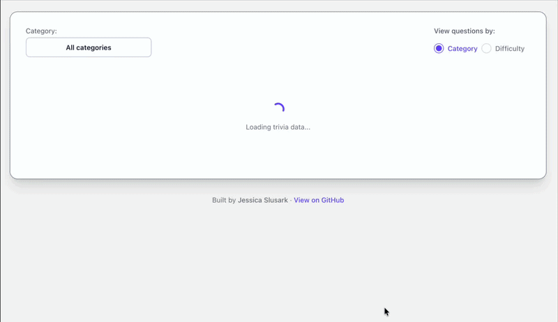
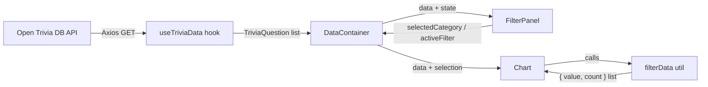

# Mini Visualization Tool

> An interactive, responsive trivia data dashboard that turns raw API responses into a clean, explorable visualization — built with React, TypeScript, and Recharts.

This project fetches **50 live trivia questions** from the [Open Trivia DB API](https://opentdb.com) and presents the resulting dataset as an interactive bar chart. You can filter the questions by category and switch views between **distribution by category** and **distribution by difficulty**.

It was built as a self-contained frontend prototype focused on typed data models, a clean component structure, async API handling, data aggregation, and a responsive UI. The app is deployed as a static site on GitHub Pages.

**Live demo:** [jslusark.github.io/mini-visualization-tool](https://jslusark.github.io/mini-visualization-tool/)



> The dashboard loads data from the live Open Trivia DB API, so an internet connection is required for the chart to populate.

---

## Table of Contents

1. [What This Is](#what-this-is)
2. [Features](#features)
3. [Tech Stack](#tech-stack)
4. [How It Is Built](#how-it-is-built)
5. [Application Data Flow](#application-data-flow)
6. [Project Structure](#project-structure)
7. [Getting Started](#getting-started)
8. [Deployment](#deployment)
9. [Configuration](#configuration)
10. [Design Decisions & Trade-offs](#design-decisions--trade-offs)
11. [Known Issues](#known-issues)
12. [Roadmap & Future Improvements](#roadmap--future-improvements)

---

## What This Is

The **Mini Visualization Tool** is a single-page application that answers one simple question: *"What does this trivia dataset look like?"* Instead of dumping raw JSON on screen, it:

1. Requests trivia questions from a public REST API.
2. Decodes the URL-encoded response into a typed data model.
3. Aggregates the data into a grouped distribution.
4. Renders that distribution as an interactive, responsive bar chart.
5. Lets the user refine the view by category and metric.


---

## Features

| Feature | Description |
| --- | --- |
| **Live API integration** | Fetches 50 questions from Open Trivia DB with `encode=url3986` and decodes all text fields. |
| **Category filter** | A dropdown lists the unique categories found in the fetched data, plus an "All categories" option. |
| **View toggle** | Switch between aggregating by **category** or **difficulty** with a radio toggle. |
| **Interactive chart** | Hover tooltips, animated bars, hover highlighting, and a legend that describes the current view. |
| **Responsive labels** | X-axis labels rotate, shorten, and (on very narrow screens) skip every other tick when they no longer fit. |
| **Request states** | Dedicated loading, error, and empty-state components. |
| **Styled UI** | Built with DaisyUI + Tailwind CSS using a custom DaisyUI theme. |
| **Static deployment** | Automatic deploys to GitHub Pages via GitHub Actions, plus a manual `gh-pages` script. |

---

## Tech Stack

| Layer | Technology | Purpose |
| --- | --- | --- |
| **Language** | TypeScript | Typed data models, component props, and shared interfaces. |
| **UI library** | React 19 | Component-based UI with hooks. |
| **Build tool** | Vite 7 | Fast dev server and optimized production builds. |
| **HTTP client** | Axios | Fetching the trivia API data. |
| **Charting** | Recharts 3 | Declarative, responsive bar charts. |
| **Styling** | Tailwind CSS 4 + DaisyUI 5 | Utility-first styling and prebuilt UI components/theme. |
| **Linting** | ESLint 9 | Code quality via `typescript-eslint` and React hooks/refresh plugins. |
| **Deployment** | GitHub Actions / `gh-pages` | Static hosting on GitHub Pages. |

---

## How It Is Built

### Architecture Overview

The project follows a **component-driven architecture** with clear separation of concerns:



- **Data layer** — `hooks/useTriviaData.tsx` owns the network request and its lifecycle.
- **State layer** — `components/DataContainer.tsx` holds the active view and the selected category, and picks which request state to render.
- **UI layer** — `components/filterPanel/*` and `components/chart/*` are driven by props.
- **Logic layer** — `utils/filterData.tsx` and `utils/colorUtils.tsx` hold pure, reusable functions.
- **Types layer** — `types.ts` defines the shared TypeScript interfaces.

### Component Breakdown

#### `DataContainer.tsx`

The orchestration component. It:
- Calls `useTriviaData(50)` to kick off the fetch.
- Holds two pieces of UI state: `activeFilter` (`category` or `difficulty`) and `selectedCategory`.
- Renders one of: loading spinner → error message → empty state → chart.
- Passes props down to `FilterPanel` and `Chart`, keeping data flow one-directional.

#### `hooks/useTriviaData.tsx`

A custom hook encapsulating the API call:
- Uses `useState` for `data`, `error`, and `isLoading`.
- Fetches with Axios and decodes `category`, `question`, `correct_answer`, and `incorrect_answers` using `decodeURIComponent` (because the request uses `encode=url3986`).
- Waits **5 seconds** before sending the request so the loading state is visible during development.
- Clears its timer on unmount.

#### `filterPanel/FilterPanel.tsx`

Lays out the category dropdown and the view toggle side by side (stacked on small screens).

#### `filterPanel/CategorySelect.tsx`

- Derives a **unique, alphabetically sorted list of categories** from the data using `Set` and `sort()`.
- Prepends an "All categories" option and hides the currently selected entry from the list.
- Renders a DaisyUI hover dropdown; selecting "All categories" resets the filter to `null`.

#### `filterPanel/FIlterToggle.tsx`

- Maps the two view options (`category`, `difficulty`) to radio inputs.
- Highlights the active option and calls `onChange` to lift the selection up to `DataContainer`.

#### `chart/Chart.tsx`

The visualization centerpiece:
- Computes chart data via `filterData` for the current category and view.
- Tracks viewport width with a `resize` listener to decide whether to **rotate and truncate labels**.
- Uses a linear scaling rule: labels rotate when the label count exceeds `5 * (width / 640)`. Below 500px wide, rotated labels show every other tick.
- Shortens category prefixes to three letters (e.g. `Entertainment: Video Games` → `Ent: Video Games`) and trims labels with an ellipsis (17 characters when rotated, 25 otherwise).
- Colors bars and ticks differently depending on the active view via `customiseColor`.
- Shows the tooltip only while the pointer is over a bar.

#### `loading/*` (LoadingSpinner, ErrorMessage, EmptyState)

Small presentational components for each request state.

#### `layout/footer.tsx`

A simple footer with author credits and a link to the repository.

### Utility Layer

#### `utils/filterData.tsx`

The core data transformation:
1. Optionally filters questions by `selectedCategory`.
2. Counts occurrences of the chosen field (`category` or `difficulty`).
3. Returns `{ value, count }` pairs sorted alphabetically with `localeCompare` (case-insensitive).

#### `utils/colorUtils.tsx`

- `colorScheme` mirrors the DaisyUI theme tokens as `oklch()` values so Recharts can use the same palette.
- `customiseColor` maps the active view to idle/active colors (secondary for category, accent for difficulty).

#### `types.ts`

- `TriviaQuestion` — the shape of one decoded API record.
- `FilteredItem` — the shape of aggregated chart data.
- `FilterToggleProps` — the props contract for the toggle component.

---

## Application Data Flow

1. **Fetch** — `useTriviaData(50)` requests 50 URL-encoded questions from Open Trivia DB.
2. **Normalize** — Text fields are decoded and stored as `TriviaQuestion` objects.
3. **Store** — `DataContainer` holds the questions, the active view, and the selected category.
4. **Aggregate** — `Chart` calls `filterData`, which narrows the questions and counts matching values.
5. **Render** — `Chart` draws the bar chart; the filter panel lets the user change the view.

---

## Project Structure

```text
mini-visualization-tool/
├── .github/workflows/
│   └── deploy.yml                # Build + deploy to GitHub Pages
├── public/                       # Static assets served as-is
├── src/
│   ├── assets/
│   │   ├── mockData.json         # Sample API response (not used by the app)
│   │   └── preview.gif           # README preview
│   ├── components/
│   │   ├── chart/
│   │   │   └── Chart.tsx         # Responsive Recharts bar chart
│   │   ├── filterPanel/
│   │   │   ├── CategorySelect.tsx  # Category dropdown filter
│   │   │   ├── FilterPanel.tsx     # Combines select + toggle
│   │   │   └── FIlterToggle.tsx    # Category/difficulty view toggle
│   │   ├── layout/
│   │   │   └── footer.tsx        # Author + repo footer
│   │   ├── loading/
│   │   │   ├── EmptyState.tsx      # No-data state
│   │   │   ├── ErrorMessage.tsx    # Error state
│   │   │   └── LoadingSpinner.tsx  # Loading state
│   │   └── DataContainer.tsx     # Orchestrates data + state
│   ├── constants/
│   │   └── constants.ts          # API URLs, view options, max questions
│   ├── hooks/
│   │   └── useTriviaData.tsx     # Custom data-fetching hook
│   ├── styles/
│   │   ├── App.css
│   │   └── index.css             # Tailwind + DaisyUI theme
│   ├── utils/
│   │   ├── colorUtils.tsx        # Theme colors + chart color mapping
│   │   └── filterData.tsx        # Filter + aggregate logic
│   ├── App.tsx                   # App shell + layout
│   ├── main.tsx                  # React entry point
│   └── types.ts                  # Shared TypeScript interfaces
├── index.html
├── package.json
├── vite.config.ts                # Vite + base path config
├── tailwind.config.js
├── postcss.config.cjs
├── tsconfig*.json
└── eslint.config.js
```

---

## Getting Started

### Prerequisites

- **Node.js 20.19+** or **22.12+** (required by Vite 7)
- **npm**

### Install and run

```bash
npm install
npm run dev
```

Vite prints the local URL (usually `http://localhost:5173/mini-visualization-tool`). Open it to see the app with hot reload.

### Other scripts

| Command | What it does |
| --- | --- |
| `npm run lint` | Runs ESLint. |
| `npm run build` | Type-checks with `tsc -b`, then builds to `dist/` with Vite. |
| `npm run preview` | Serves the production build locally. |
| `npm run deploy` | Publishes `dist/` to the `gh-pages` branch. |

---

## Deployment

There are two ways the site gets deployed:

- **GitHub Actions (automatic)** — `.github/workflows/deploy.yml` builds and deploys to GitHub Pages on every push to `main` or `mini_visualization_tool`, and can also be run manually from the Actions tab. This requires the repository's Pages source to be set to **GitHub Actions**.
- **`gh-pages` (manual)** — `npm run deploy` pushes the current `dist/` folder to the `gh-pages` branch. It does **not** build first, so run `npm run build` before it.

---

## Configuration

- **Vite base path** — `vite.config.ts` sets `base: "/mini-visualization-tool"` so asset paths resolve under the GitHub Pages sub-path. Change this if you rename the repository.
- **TypeScript** — split into `tsconfig.json`, `tsconfig.app.json`, and `tsconfig.node.json`, with `verbatimModuleSyntax` enabled so types are imported with `import type`.
- **Styling** — Tailwind CSS 4 runs through `postcss.config.cjs` (`@tailwindcss/postcss`), with the DaisyUI 5 plugin and a custom `mytheme` theme defined in `src/styles/index.css`.
- **Linting** — `eslint.config.js` uses `@eslint/js`, `typescript-eslint`, `eslint-plugin-react-hooks`, and `eslint-plugin-react-refresh`.

---

## Design Decisions & Trade-offs

- **One-directional data flow** — Shared state lives in `DataContainer`; children receive props and report changes through callbacks.
- **Pure utility functions** — `filterData` and the color helpers have no side effects, which makes them easy to unit test later.
- **Computed label rotation** — Rotation is calculated from `window.innerWidth` and the number of labels with a linear rule instead of fixed CSS breakpoints. This adapts to the data but needs a resize listener.
- **Visible loading state** — The hook deliberately delays the request so the loading UI can be seen and checked.
- **Typed API records** — The decoded response is typed as `TriviaQuestion`, so components get compile-time checks on the fields they use.

---

## Known Issues

- **Constants not fully used** — `API_BASE_URL` and `MAX_QUESTIONS` exist in `constants.ts`, but the hook and `DataContainer` still hard-code the URL and `50`. `API_CATEGORY_URL` is unused.
- **Open Trivia DB rate limits** — the API allows one request per IP every 5 seconds, so reloading quickly can return an empty or error response.

---

## Roadmap & Future Improvements

From the TODOs in the code:

- **Local-storage caching** to reduce repeated API calls and support offline use.
- **Automated tests** — unit tests for `filterData`, integration tests for the API hook.
- **Loading more than 50 questions** — the API caps a single request at 50, so this needs multiple requests.
- **Smaller batches for very large datasets** (1000+ items).

Other ideas:

- **Runtime validation** of the API response (e.g. with Zod).
- **Lint and test steps** in the GitHub Actions workflow.
